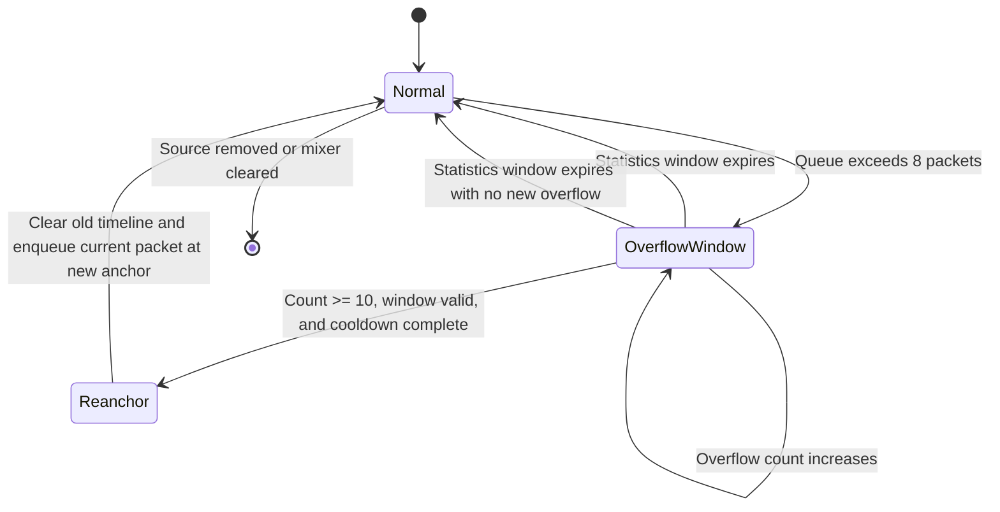

# Microphone queue-overflow recovery design

## Background

Each remote microphone source buffers at most eight 20 ms Opus packets. When packets briefly arrive faster than the host can play them, the mixer drops the farthest packet in the future. Occasional overflow is a normal real-time degradation. Sustained overflow, however, can leave the source's receive timeline permanently misaligned with the host playback timeline, causing more PLC, intermittent audio, or abnormal playback progress.

This mechanism only restores the playback timeline of one microphone source. It does not repair the network, client send cadence, or host scheduling.

## Parameters and tradeoffs

| Parameter | Value | Purpose |
| --- | ---: | --- |
| Maximum buffer per source | 8 packets | Absorb short bursts while retaining a fixed upper bound |
| Maximum future timeline window | 16 frames (about 320 ms) | Let the larger bounded queue absorb a burst before treating it as a timeline jump |
| Overflow statistics window | 250 frames (about 5 seconds) | Determine whether overflow is sustained |
| Re-anchor threshold | 10 overflows | Prevent one reordered packet from triggering recovery |
| Re-anchor cooldown | 100 frames (about 2 seconds) | Permit another recovery during a persistent fault without repeatedly clearing the timeline |
| Jitter buffer after re-anchor | 2 frames (about 40 ms) | Give the new timeline a stable playback buffer |

The statistics window and re-anchor cooldown are independent. The statistics window determines whether overflow is sustained during the current round; the cooldown determines how long after the last overflow re-anchor another overflow re-anchor is allowed. Because the cooldown is shorter than the statistics window, a later recovery remains possible. Recovery occurs again only if subsequent enqueue attempts satisfy the threshold, window, and cooldown conditions—not automatically every two or five seconds. Frame skips and other timeline resets clear the cooldown, so it is not a global rate limit for every re-anchor path.

### Why increase the limit only to eight packets

Eight 20 ms packets contain at most about 160 ms of audio. This packet-count limit does not add a fixed 160 ms of latency and must not be added to the two-frame jitter buffer to calculate actual latency. The anchor and two-frame prebuffer still determine the first frame's playback position; the queue merely lets future packets wait during a short burst.

A modestly larger queue reduces drops when a batch of packets arrives over a short interval, but:

- any finite capacity is eventually exhausted when the send rate remains above the playback rate;
- expired packets are still dropped, and a packet more than 16 slots into the future still triggers the existing timeline reset;
- each source retains at most four additional Opus packets, still with a fixed bound; microphone latency increases further only if the playback position is also delayed.

The capacity therefore increases from four to eight packets while the initial prebuffer remains two frames. Future work should compare capacities and prebuffer settings using arrival intervals, burst sizes, queue occupancy, and acceptable latency; the queue must not grow without a bound.

## State flow

## Receive and recovery logic

1. On the first queue overflow, record the current host playback slot as the start of the statistics window.
2. Accumulate overflows within the window. Do not clear the current window when the queue briefly recedes and a packet is enqueued successfully; otherwise, a series of short bursts could never reach the recovery threshold.
3. Before each check, clear the old count if the statistics window has expired. A new overflow then starts a new window.
4. After ten overflows have accumulated, when a later packet passes sequence-number, timeline, and lateness checks, re-anchor if the window is still valid and more than 100 frames have elapsed since the previous overflow re-anchor (with no cooldown for the first one):
   - reset the Opus decoder and source timeline;
   - clear the old queue;
   - place the current packet two frames after the current playback slot;
   - clear the old overflow state and record the new re-anchor slot.
5. When the host playback thread skips frames, the source timeline resets, or the session is cleared, also clear the overflow window and re-anchor cooldown so old-cycle state cannot affect the new cycle.

## User-visible behavior

Re-anchoring resets the decoder, clears the old queue, and marks the source as not yet started. The new packet waits for two playback slots; during that interval the source emits no audio and does not invoke Opus PLC. If it is the only source, the mixer returns no result and the playback thread does not write that frame. Other active sources can continue to mix.

With normal 20 ms scheduling, first output occurs about 40–60 ms after the re-anchor enqueue. Output-device buffering and scheduling also affect perception, so the design cannot guarantee a seamless result or a maximum 40 ms interruption. During sustained overflow, another re-anchor occurs only when a later packet satisfies the recovery conditions.

If `queue_overflow` and `plc` continue growing for a long time, the network, client sender, or host scheduler is still unhealthy. Re-anchoring limits how long a timeline error persists; it does not replace correction of the root cause.

## Validation scope

- Unit tests cover the eight-packet queue capacity and overflow of the ninth future packet.
- Unit tests cover re-anchoring after sustained overflow reaches the threshold.
- Unit tests cover playback of the current packet at the new anchor after re-anchoring.
- Unit tests cover retaining statistics when the queue briefly recedes and the window boundary after a host frame skip, ensuring that stale state cannot trigger a re-anchor incorrectly.
- Physical-device validation must observe `queue_overflow`, `reanchors`, `plc`, and WASAPI dropped-frame statistics during a long streaming session.
