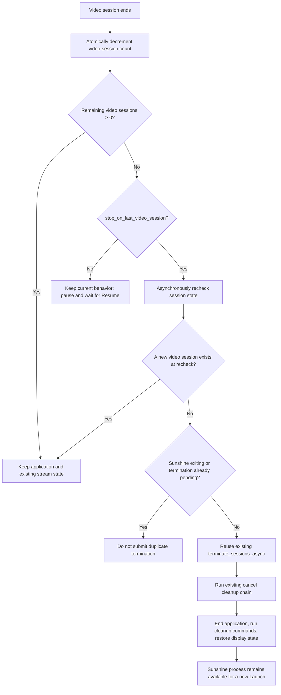

# Stop streaming when the last video session ends

## Goal

Sunshine currently keeps the application and streaming context after the last video session ends so that a client can resume after a brief disconnection. This is the current default and must not change.

This design adds an optional global policy: when the last non-control video session ends, actively end the stream and clean up the application. Users can enable it when their network is unreliable or when they want automatic cleanup after leaving the computer. When disabled, the existing disconnect-recovery behavior remains unchanged.

The goal is a simple user switch, not a session-management redesign. It adds no HTTP endpoint, wait timer, or per-application configuration, and it does not duplicate the cleanup flow.

## User entry point

Location: WebUI → General.

Add a checkbox to the existing global streaming settings on the General page:

> End streaming after all clients disconnect

Description:

> When enabled, Sunshine ends the application and restores display state after all clients disconnect. When disabled, it keeps the existing disconnect-recovery behavior. Automatic cleanup also ends any retained control-only sessions.

This option:

- is disabled by default;
- is a global Sunshine setting, not an application setting;
- appears with global options such as system-tray and preview-build notifications;
- is read and saved through the existing `/api/config`, with no new frontend API;
- uses the WebUI's existing Apply action to restart Sunshine after saving, and affects subsequent sessions after that restart;
- adds no field to AppEditor, `apps.json`, or client configuration.

An ordinary user only needs to select one option. Users who prefer manual control can continue to call the existing `/cancel`.

## Configuration model

Configuration key: `stop_on_last_video_session`.

The key belongs to `stream_t` because it describes Sunshine's session-lifecycle policy, not an application's launch arguments. Sunshine's configuration layer continues to read and write the configuration. The Sunshine WebUI changes the complete configuration object through the existing API; the control panel does not need a duplicate setting.

Compatibility rules:

- treat a missing key as `false`;
- `false` preserves current behavior;
- `true` changes only the branch that handles the end of the last video session;
- if configuration saving fails, preserve the old in-memory policy and use the existing error message.

## Lifecycle logic

Existing session management already tracks the video-session count and distinguishes control-only sessions. The implementation checks the setting only on the edge where the video-session count changes from 1 to 0:

### Why an asynchronous recheck is required

A short interval can exist between the end of the last old session and execution of the automatic termination task. A client may already have started a new `Launch` during that interval. The video thread therefore must not terminate the process directly, and the decision cannot rely only on the first observed count.

Before the automatic task runs, it must confirm again that:

1. the video-session count is still zero;
2. Sunshine has not entered global shutdown;
3. no other termination task is running.

If any condition fails, the automatic task exits without affecting the new session.

### Concurrency and idempotence

- The video-session count continues to use existing atomic operations. Only one session can observe the transition from 1 to 0.
- An automatic termination request uses a one-shot submission flag, so when two sessions end almost simultaneously, at most one task is submitted. This flag only deduplicates requests; it is not a Launch/Resume admission lock.
- Cleanup already triggered by manual `/cancel` or host shutdown is not run again.
- Video and audio threads never wait, and the change adds no polling thread or fixed delay.

A control-only session does not decrement the video-session count and cannot trigger this option by itself. Once the last video session has selected full-stream cleanup, the existing global termination flow also finishes the related control sessions.

## Cleanup semantics

Automatic exit with this option enabled must reuse the termination coordinator used by the existing `/cancel`, not implement another cleanup path. This preserves consistent behavior for:

- terminating the current streaming application;
- running the application's undo and cleanup commands;
- restoring display configuration and virtual-display state;
- updating running state in the tray and WebUI;
- keeping the Sunshine process running.

Automatic exit changes only the trigger, not the cleanup order. If global shutdown is already in progress, do not submit an automatic-exit request.

## Stop-reason handling

| Reason the last video session ended | Behavior when enabled |
| --- | --- |
| Client disconnect or control timeout | Trigger automatic cleanup |
| RTSP/protocol error | Trigger automatic cleanup |
| Video thread exit or device fault | Trigger automatic cleanup |
| Manual `/cancel` already running | Reuse existing cleanup; do not submit again |
| Sunshine is shutting down | Skip automatic submission; shutdown owns cleanup |

This is not a new default that kills the process on every network disturbance. It activates only when the user explicitly enables the option and the last video session ends. With the option disabled, existing Resume behavior and manual `/cancel` remain available.

## Validation scope

### Configuration and interface

- The General page shows the option disabled by default.
- After toggling and saving, reopening the page preserves the state.
- After selecting Apply and completing the restart, the next session end reads the new policy.
- Text labels do not alter the existing control layout.
- A missing configuration key is still treated as disabled.

### Session lifecycle

- With the default disabled, the last client can still Resume after disconnecting.
- When enabled, ending the last video session exits the application, runs cleanup commands, and restores display state.
- With two video sessions present, the first client to disconnect does not trigger exit.
- A new Launch immediately after the last video session disconnects is not terminated by the old session's automatic task.
- A control-only session connecting or disconnecting alone does not trigger the option.
- Manual `/cancel` behavior remains unchanged and produces no duplicate cleanup.
- Cover existing display-restoration cases: physical displays, VDD, lock screen, and SYSTEM RDP.

## Non-goals and tradeoffs

This phase explicitly excludes:

- a second parameter that waits N seconds after disconnect before exit;
- per-application switches;
- a new `/cancel` variant or remote-control endpoint;
- counting control-only sessions as video sessions;
- changing the default Resume semantics.

Users who need a finer-grained policy can leave the option disabled and use the existing `/cancel`. Keeping this scope avoids turning a simple lifecycle preference into a new session-policy system.

## Impact and risk

The primary impact is intentional: when enabled, a brief network disruption that ends the last video session exits the application instead of waiting for Resume. Keeping the option disabled by default protects existing users.

The implementation adds no high-frequency lock, network request, or background polling. It submits one asynchronous termination request only on the low-frequency edge where the video-session count reaches zero, then confirms state again before execution. The one-shot flag prevents duplicate cleanup but cannot atomically cover the complete Launch/Resume admission interval between checking the conditions and starting cleanup. Full coordination is deferred to the separate design in `stream_lifecycle_coordinator_design.md`.
