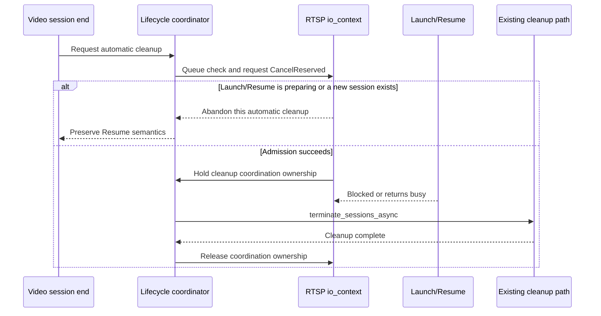

# Stream lifecycle coordinator design

## Purpose

"End streaming after all clients disconnect" changes only the trigger for automatic cleanup; it must not turn `stream.cpp` into a new global session state machine. The current implementation continues to reuse the existing RTSP session-cleanup path. This design describes how a later version can coordinate Launch/Resume preparation with automatic cleanup.

## Current-version boundary

The current feature submits one asynchronous automatic cleanup after the video-session count reaches zero, then rechecks video sessions and pending tickets in the RTSP execution context. This prevents duplicate submissions and clearly stale cleanup, but a new Launch/Resume can still arrive between checking the conditions and starting cleanup. The current feature does not expand that interval into a heavyweight state machine. A later change should receive separate review and validation.

## Design principles for the follow-up

- Add one RTSP component responsible for coordinating Launch/Resume admission with automatic cleanup; do not rewrite the video- or audio-thread lifecycle.
- The RTSP `io_context` owns the state. High-frequency media paths gain no mutex or polling thread.
- A pending cleanup must acquire coordination ownership before clearing tickets and sessions. Until it releases ownership, a new Launch/Resume cannot enter a phase that the cleanup would overwrite.
- Manual `/cancel`, host shutdown, and automatic cleanup share one cleanup entry point, preserving stop order and idempotence.
- Control-only sessions do not count toward the "last video session" trigger. Once global cleanup is admitted, however, the same entry point finishes them too.
- Every failure, cancellation, timeout, and exception must release coordination ownership; Sunshine must never remain permanently stuck in "stopping."

## Minimal state model

The states represent only phases that require coordination across requests; they do not duplicate per-client information:

| State | Meaning |
| --- | --- |
| `Idle` | No global cleanup is pending; a new Launch/Resume is allowed. |
| `Preparing` | Launch/Resume has acquired admission and is creating the display, ticket, or RTSP session. |
| `CancelReserved` | Automatic or manual cleanup has acquired coordination ownership; a new Launch/Resume must wait or explicitly return busy. |
| `Stopping` | Existing session cleanup, application termination, and display restoration are running. |

The new state machine does not copy the video-session count, pending-ticket count, or control-only session count. Existing RTSP and stream counters remain the sources of truth.

## Key invariants

1. Automatic cleanup may begin only when the video-session count is zero, no Launch/Resume is pending, and it can acquire `CancelReserved`.
2. From acquisition of `CancelReserved` through cleanup completion, a new Launch/Resume cannot pass the admission check. Otherwise, automatic cleanup must abort and release ownership.
3. Cleanup can run only through the existing `terminate_sessions_async` path. Application termination, cleanup commands, and display restoration must not be duplicated.
4. `CancelReserved`, `Stopping`, and completion callbacks may receive duplicate requests, but the final effect must be idempotent.
5. Sunshine process shutdown takes priority over automatic cleanup; the shutdown flow releases all remaining state.

## Flow

```mermaid
stateDiagram-v2
    [*] --> Idle
    Idle --> Preparing: Admit Launch/Resume
    Preparing --> Idle: Preparation fails or session is not created
    Preparing --> Idle: Session creation completes
    Idle --> CancelReserved: Last video session ends with policy enabled
    CancelReserved --> Preparing: New Launch/Resume found; abandon automatic cleanup
    CancelReserved --> Stopping: Recheck confirms no new admission
    Stopping --> Idle: Existing cleanup path completes
    Idle --> Stopping: Manual /cancel or host shutdown
    Preparing --> Stopping: Manual /cancel or host shutdown
```

Another way to express the rule is "reserve admission before cleanup," rather than "read a few counters and guess whether cleanup is safe":

## Interaction and failure handling

- Setting disabled: preserve existing disconnect-recovery behavior completely and do not take the coordinator's automatic-cleanup branch.
- Setting enabled but a new Launch/Resume has begun: abandon this automatic cleanup and do not terminate the new session.
- Cleanup fails: write a stable local log and release coordination ownership; do not prevent Sunshine from accepting a later Launch.
- Manual `/cancel` or host shutdown: prefer the existing termination reason and cleanup order, without duplicating automatic cleanup.
- Only control-only sessions remain: do not trigger automatic cleanup. If automatic cleanup has already been admitted, end them through the global path.

## Validation requirements

A follow-up implementation must cover at least:

1. the last video session ending at the same time as Launch/Resume arrives;
2. only one of several simultaneous Launch/Resume requests acquiring admission;
3. automatic cleanup interleaved with manual `/cancel` and host shutdown;
4. coordination ownership being released after a cleanup callback throws, is cancelled, or times out;
5. cleanup while control-only sessions exist;
6. unchanged legacy Resume behavior when the setting is disabled.

Real VDD, display restoration, and client Resume still require integration validation on Windows. Unit tests cannot replace driver validation.

## Non-goals

The follow-up coordinator is not responsible for:

- rewriting video- or audio-thread state;
- adding a per-application lifecycle policy;
- adding a wait duration, polling thread, or remote-control endpoint;
- changing client Resume protocol fields.
